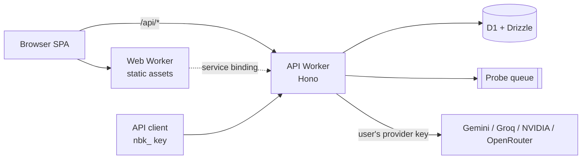

# numbat

[](https://github.com/saxeum/numbat/actions/workflows/ci.yml)

A bring-your-own-key AI gateway and chat UI, running entirely on Cloudflare
Workers. Live at **[foonix.net](https://foonix.net)**.

Connect a key from Google Gemini, Groq, NVIDIA, or OpenRouter. Keys are encrypted
at rest and used only to proxy requests on your behalf — the service never
returns them. Use the browser UI, or call the OpenAI-compatible gateway API with
a `nbk_` key.

## What it does

- **Chat** — streaming responses, model picker, conversation history, per-message
  token and throughput stats.
- **BYOK credentials** — one stored key per provider, encrypted with envelope
  encryption; only a fingerprint is readable back through the API.
- **Gateway API** — `POST /api/chat/completions` accepts an OpenAI-shaped request
  and an `Authorization: Bearer nbk_…` key. The OpenAPI document is the contract.
- **Probe reports** — test every model against your own key; results drive which
  models the picker offers.
- **Operations** — rate limiting, request IDs, structured logs, health check with
  a database probe, and hardened response headers.

## Architecture

Two Workers share one origin, so there is no CORS layer:



`apps/worker` holds the Hono API, `apps/web` the React SPA, `packages/api` the
generated Zod contracts, and `packages/probe` the model probe engine. See
[`docs/architecture.md`](docs/architecture.md) for the request lifecycle and
decisions.

## Quickstart

Requires Node 24+ and a Cloudflare account for `wrangler`.

```bash
npm ci
cp apps/worker/.dev.vars.example apps/worker/.dev.vars   # fill in the values

cd apps/worker
npx wrangler d1 migrations apply numbat-db --local
cd ../..

npm run dev    # API on :8787, SPA on :5173
```

The SPA proxies `/api` to the API Worker. In development, password sign-in is
enabled so you can create an account without an OAuth client.

### Configuration

| Variable | Required | Purpose |
|---|---|---|
| `BYOK_KEK` | yes | Base64 of 32 random bytes. Wraps per-record data keys for stored provider credentials |
| `BYOK_KEK_VERSION` | no | Label for the active KEK (default `1`) |
| `BETTER_AUTH_URL` | yes | Public origin, e.g. `https://foonix.net` |
| `BETTER_AUTH_SECRET` | yes | Session signing secret |
| `GOOGLE_CLIENT_ID` / `GOOGLE_CLIENT_SECRET` | yes | Google OAuth client |
| `GATEWAY_LLM_LOGGING` | no | `1` logs truncated provider traces; keep it off outside debugging |

Production secrets are set with `wrangler secret put`. CI needs
`CLOUDFLARE_API_TOKEN` and `CLOUDFLARE_ACCOUNT_ID`.

## API

All routes live under `/api`; everything except `/api/health` requires a session
or a gateway key.

| Route | Purpose |
|---|---|
| `GET /health` | liveness plus a database probe |
| `GET`, `POST /credentials`; `DELETE /credentials/{id}` | connect, list, and remove provider keys |
| `GET /models` | models available to the caller |
| `POST /chat/completions` | proxied completion (streaming supported) |
| `GET/POST /conversations` | chat history |
| `GET/POST /reports` | probe reports and per-model availability |
| `GET`, `POST /keys`; `DELETE /keys/{id}` | gateway API keys |
| `GET /docs` | Swagger UI (session required) |

## Security model

- **Credentials at rest** — an AES-256-KW key-encryption key wraps a per-record
  AES-256-GCM data key; the ciphertext is bound to owner, provider, and label via
  additional authenticated data. Plaintext exists only while proxying a request.
  The API returns a fingerprint, never the key.
- **Gateway keys** — `nbk_` tokens are 32 random bytes, stored as SHA-256 only,
  revocable, and scoped to their owner.
- **Sessions** — Better Auth on the same origin as the SPA; no cross-origin API
  surface.
- **Headers** — HSTS, frame denial, `nosniff`, and a restrictive
  `Permissions-Policy` on both Workers, plus a CSP on the SPA.
- **Abuse limits** — 120 requests/minute per IP per Cloudflare location, plus a
  per-user cap on probe reports.
- **Logging** — provider keys are never logged. Request and response bodies are
  only traced when `GATEWAY_LLM_LOGGING` is enabled, and it is off in production.
- **Disclosure** — please report vulnerabilities privately; see
  [`SECURITY.md`](SECURITY.md).

This is a small pre-1.0 project and has not been independently audited.

## Documentation

| Document | Contents |
|---|---|
| [`docs/architecture.md`](docs/architecture.md) | System design, request lifecycle, decisions |
| [`docs/frontend.md`](docs/frontend.md) | Frontend stack and conventions |
| [`docs/rate-limiting.md`](docs/rate-limiting.md) | How limits work and how to test them |
| [`docs/incident-response.md`](docs/incident-response.md) | Severity, rollback, D1 recovery |
| [`docs/free-token-onboarding.md`](docs/free-token-onboarding.md) | Getting provider keys |
| [`docs/google-oauth-setup.md`](docs/google-oauth-setup.md) | Creating the OAuth client |
| [`docs/gateway-tutorial.md`](docs/gateway-tutorial.md) | Local gateway walkthrough |

## Contributing

Short-lived branches, pull requests, and a required `typecheck · test · build`
check. See [`CONTRIBUTING.md`](CONTRIBUTING.md) and [`agents.md`](agents.md).

## License

[Apache-2.0](LICENSE).
