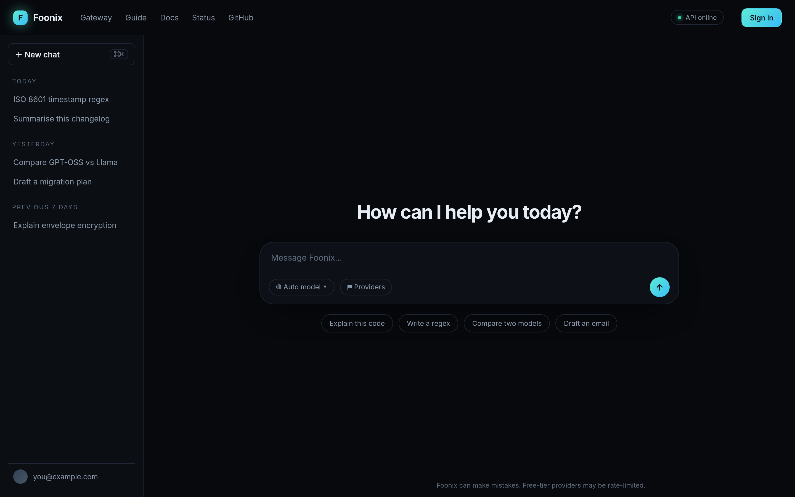
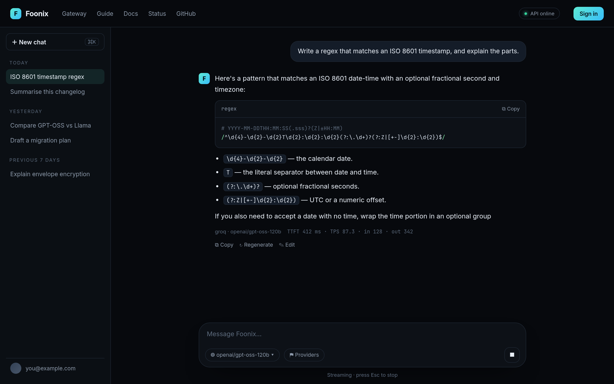
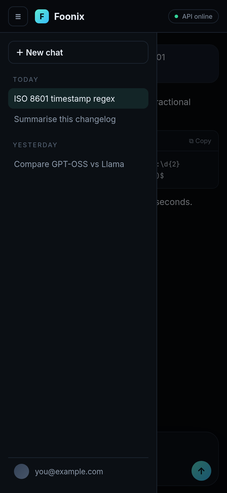

# Foonix — Chat UI redesign (Claude-parity)

- **Status:** Proposed
- **Date:** 2026-10-21
- **Scope:** The authenticated chat surface at `/gateway/chat` in `apps/web`, plus
  the persistence and API work it requires.
- **Reference:** <https://claude.ai/new> — parity of *feel*, not a pixel copy.
- **Companions:** [`frontend.md`](frontend.md), [`architecture.md`](architecture.md),
  [`persistence-plan.md`](persistence-plan.md), [`openapi-plan.md`](openapi-plan.md),
  [`gateway-tutorial.md`](gateway-tutorial.md).

This is a design document. No code is written until explicitly requested (see
`agents.md`).

---

## 1. Summary

Today the gateway chat is a **single-shot form**: pick a provider/model, type one
prompt, get one completion in a result card. There is no conversation, no history,
no message thread, and no markdown.

This proposes replacing it with a **conversational, Claude-style workspace**:

- a conversation list in a left rail,
- a centered message thread,
- a streaming composer pinned to the bottom,

while keeping Foonix's differentiators — **bring-your-own-key**, multi-provider
model selection, and live **TTFT / TPS / token** metrics.

---

## 2. Goals and non-goals

### Goals

1. Multi-turn, persisted conversations with history and deep links.
2. A chat experience that *feels* like Claude: sidebar, empty state, thread,
   composer, streaming, edit/regenerate.
3. Preserve the existing gateway capabilities: provider filtering to **connected**
   keys only, model picker, streaming on/off, cancel, and metrics.
4. Responsive (desktop two-pane, mobile drawer) and accessible (keyboard, ARIA,
   reduced motion).

### Non-goals (v1)

- Attachments, image/vision input, file uploads.
- Artifacts / canvas, tool use, code execution.
- Projects, sharing, collaboration, cross-conversation search.
- Advanced sampling controls (temperature, top-p) and a system-prompt editor.

---

## 3. Current state

| Concern | Today |
|---|---|
| Route | `/gateway/chat` → `GatewayChatPage`, inside `GatewayLayout` tabs (Chat / Provider credentials / API tokens) |
| Inference | `useChat()` mutation → `POST /api/chat/completions` |
| Streaming | Supported (`stream: true`, SSE); `readStream()` parses deltas; `AbortController` cancel |
| Providers | `gemini`, `groq`, `nvidia`, `openrouter` (filtered to those with a connected credential) |
| UI | provider multi-select (`<details>`), model `<select>`, "Stream response" checkbox, single-line `Input`, Send/Cancel, result card with metrics |
| Persistence | **None** — nothing is stored; refresh loses everything |
| Rendering | `whitespace-pre-wrap` plain text (no markdown) |

Relevant files: `apps/web/src/routes/gateway-chat.tsx`,
`apps/web/src/features/gateway/{api,hooks,ui}.ts`,
`apps/worker/src/api/routes/chat.ts`.

---

## 4. Reference experience (what we're matching)

The Claude chat surface at `claude.ai/new` has a small number of very deliberate
pieces. We target the same *anatomy and behaviour*:

| Piece | Claude behaviour | Our parity target |
|---|---|---|
| Left rail | New chat, history grouped by recency, account at the bottom, collapsible | Conversation list grouped Today / Yesterday / Previous 7 days / Older |
| Main column | Centered thread, generous whitespace, ~48rem measure | `max-w-3xl` thread + composer |
| New chat | Greeting + composer centered vertically + suggestion chips + model picker | Same, with Foonix copy |
| Composer | Large rounded, auto-growing, send (↑) → stop (■) while streaming, model picker | Same; plus provider filter + metrics affordance |
| User message | Right-aligned bubble | Right-aligned bubble |
| Assistant message | Left-aligned, full-width, **markdown**, no bubble | Same, plus provider/model + metrics footer |
| Message actions | Copy, retry, thumbs; edit on user messages | Copy, regenerate, edit (thumbs optional) |
| Streaming | Token-by-token with a stop control; follows the stream | Same, via existing SSE |
| Scroll | Sticks to bottom unless you scroll up, then "jump to latest" | Same |
| Mobile | Sidebar collapses to a drawer | `Sheet` drawer |

**Where we intentionally diverge:** Foonix keeps its dark "Developer Gateway"
identity (see [`frontend.md`](frontend.md)), adds a provider filter, and surfaces
per-message performance metrics — Claude does not.

---

## 5. Target UX

### 5.1 App shell

The chat tab becomes a two-pane workspace:

```
┌───────────────────────────── Gateway ─────────────────────────────┐
│  header (brand · nav · api status · account)                       │
├───────────────┬────────────────────────────────────────────────────┤
│  + New chat   │                                                    │
│               │            (thread / empty state)                  │
│  Today        │                                                    │
│   · Q3 plan   │                                                    │
│   · regex     │                                                    │
│  Yesterday    │                                                    │
│   · ...       │                                                    │
│               │                                                    │
│  ─────────    ├────────────────────────────────────────────────────┤
│  account      │  composer (auto-grow · model · send/stop)          │
└───────────────┴────────────────────────────────────────────────────┘
```

- Desktop (≥1024px): `grid grid-cols-[260px_1fr]`; the sidebar can collapse to a
  narrow icon rail.
- The credentials/tokens tabs keep the current single-column layout; the rail is
  chat-only (or shown dimmed).
- The page keeps `SiteHeader` / `SiteFooter`.

### 5.2 Conversation sidebar

- **New chat** button at the top (`⌘/Ctrl+K`).
- Conversations grouped by `updatedAt`: **Today**, **Yesterday**, **Previous 7
  days**, **Older**.
- Each item: title (derived from the first user message, ~40 chars), with
  hover-revealed **rename** and **delete**.
- Active conversation highlighted; skeleton rows while loading.
- Account menu pinned to the bottom (reuse `UserMenu`).

### 5.3 Empty state (new conversation)

```
                    How can I help you today?

        ┌───────────────────────────────────────────────┐
        │  Message Foonix…                    [model ▾] │
        │                                      ( ↑ )    │
        └───────────────────────────────────────────────┘
     [ Explain this code ] [ Write a regex ] [ Compare models ] [ Draft ]
```



- Greeting + centered composer; the composer **docks to the bottom** after the
  first message.
- 4 suggestion chips seed the composer.
- Provider filter + model picker visible and pre-selected from the last used.

### 5.4 Message thread

- **User message:** right-aligned, rounded bubble (`bg-secondary`, ~80% max
  width), plain text, hover **edit**.
- **Assistant message:** left-aligned, no bubble, full column width, **markdown**.
  Footer shows `provider · model · TTFT · TPS · tokens` and an action row
  (copy, regenerate).
- **Streaming:** partial text with a blinking caret; the composer's send button
  becomes **stop**.
- **Error:** inline alert under the assistant slot with **Retry**.
- **Stopped:** partial text kept, labelled "Stopped".
- Timestamps on hover.



### 5.5 Composer

- Auto-growing `Textarea`: 1 line → ~10 lines, then scrolls.
- **Enter** sends, **Shift+Enter** newline, IME-safe (`compositionstart/end`).
- Left: **provider filter** popover and **model** dropdown.
- Right: **Send** (up-arrow, brand gradient) disabled when empty or streaming;
  while streaming → **Stop** (square).
- A small settings popover holds the **Stream** toggle (default on) and, later,
  sampling controls.
- Empty prompt no longer silently sends `"hello"` (current behaviour); the send
  button is disabled instead.

### 5.6 Model & provider picker

- Preserve the current rule: only **connected** providers' models appear.
- Provider filter moves into a popover (checkbox list + select all / clear).
- Model dropdown shows `label` + provider + context window, with type-to-filter;
  `x-free` models get a "free" badge.

### 5.7 Conversation management

- Auto-title from the first user message (heuristic, no model call).
- Inline rename; delete with confirm (`AlertDialog`).
- Routing: `/gateway/chat/:conversationId`; `/gateway/chat` starts a new one.
- Sending in a new chat creates the conversation, then appends.

### 5.8 States

Loading (skeleton) · empty · error · offline (from `/api/health`) · rate-limited
(429) · cancelled/stopped · streaming. Every state gets a defined surface — no
blank screens.

### 5.9 Responsive

- `<1024px`: single pane; the rail opens as a `Sheet` from a hamburger.
- Composer is sticky at the bottom with `env(safe-area-inset-bottom)` padding.
- Touch targets ≥ 44px.



### 5.10 Accessibility

- The streaming region uses `role="log"` with `aria-live="polite"` announced on
  **completion** (not every token) to avoid screen-reader spam.
- Focus returns to the composer after send; **edit** focuses the user textarea.
- All actions keyboard-reachable with visible focus rings (existing tokens).
- Respect `prefers-reduced-motion`: no caret blink, no smooth scroll.

---

## 6. Visual spec (mapped to existing tokens)

| Element | Spec |
|---|---|
| Canvas | `--background` (`#07090d`); panels `--card` (`#0d1117`) |
| Borders | `--border` (`#1e2733`) |
| Accent | `linear-gradient(135deg, var(--primary), var(--brand-2))` |
| Thread measure | `max-w-3xl` (48rem), centered |
| User bubble | `rounded-2xl`, `bg-secondary`, `px-4 py-3`, max-w 80%, right-aligned |
| Assistant prose | 16px / 1.7, `text-foreground`; links `--primary` |
| Composer | `rounded-3xl`, `border`, `bg-card`, `shadow`, focus ring `--ring` |
| Sidebar item | `rounded-lg`, active `bg-primary/10 text-foreground` |
| Code block | `rounded-xl border bg-card`; header row = language + copy button; mono 12.5px |
| Send button | `size-9 rounded-full`, brand gradient; Stop = outline square |
| Radius scale | from `--radius` (0.75rem) |

---

## 7. Data model & API

### 7.1 Persistence — D1 + Drizzle (recommended)

Add two owner-scoped tables (migration `0005_conversations.sql`, Drizzle schema,
journal + snapshot):

```sql
conversations(
  id text pk, owner_id text → user(id) on delete cascade,
  title text not null default '',
  model text, provider text,
  created_at text, updated_at text
)
messages(
  id text pk, conversation_id text → conversations(id) on delete cascade,
  owner_id text → user(id) on delete cascade,
  role text,                    -- user | assistant | system
  content text,
  model text, provider text,
  prompt_tokens integer, completion_tokens integer, reasoning_tokens integer,
  ttft_ms integer, total_ms integer,
  stopped integer default 0, error text,
  created_at text
)
-- indexes: conversations(owner_id, updated_at), messages(conversation_id, created_at)
```

**Alternative considered — client-only (`localStorage`/IndexedDB).** Faster to
ship, no migration, but no cross-device history and metrics are lost. Rejected as
the end state; may be used as a P0 stepping stone (see §13).

### 7.2 API — stateless vs conversation-scoped

`POST /api/chat/completions` stays **stateless** for API/bearer users (unchanged).

For the UI we need persistence. Two options:

| Option | How | Pros | Cons |
|---|---|---|---|
| **A. Client-orchestrated** | Client posts to `/chat/completions` with full history, then writes user+assistant messages via the conversations API | No new streaming logic; reuses the route as-is | Two round-trips; race on failure; metrics stored client-side |
| **B. Server-orchestrated** *(recommended)* | New `POST /api/conversations/{id}/completions` appends the user message, calls the provider, streams, and persists the assistant message + usage | Single source of truth; metrics/usage persisted server-side; no double-write | Extract the provider call from `chat.ts` into a shared service; more work |

**Recommendation:** ship **A** in P0 (client persistence) and move to **B** when
D1 persistence lands in P1. Extract the provider dispatch in `chat.ts` into a
`gateway/completions.ts` service so both routes share it.

Conversations API (session-only, owner-scoped, mirrors `/credentials`):

```
GET    /api/conversations              → list { id, title, updatedAt }
POST   /api/conversations              → create (optional title) → 201
GET    /api/conversations/{id}         → conversation + messages[]
PATCH  /api/conversations/{id}         → rename { title }
DELETE /api/conversations/{id}         → 204
```

### 7.3 OpenAPI + codegen

Add `Conversation`, `ConversationDetail`, `Message`, `CreateConversationRequest`,
`UpdateConversationRequest` schemas and the paths above; run `npm run api:gen` and
commit the regenerated `packages/api` + `apps/worker/openapi.json` (CI drift
check). Swagger examples for a two-turn conversation.

---

## 8. Frontend architecture

```
apps/web/src/features/chat/
├── api.ts                 # fetch wrappers for conversations + completions
├── hooks.ts               # useConversations, useConversation, useSendMessage, …
├── types.ts
├── useChatStream.ts       # in-flight streaming state (text, abort, metrics)
└── components/
    ├── ChatWorkspace.tsx      # shell: rail + thread + composer
    ├── ConversationSidebar.tsx
    ├── ConversationList.tsx
    ├── MessageList.tsx
    ├── MessageItem.tsx        # user bubble vs assistant prose
    ├── MarkdownMessage.tsx    # lazy-loaded renderer
    ├── MessageActions.tsx
    ├── Composer.tsx
    ├── ModelPicker.tsx
    ├── ProviderFilter.tsx
    ├── EmptyState.tsx
    └── JumpToLatest.tsx
```

- `routes/gateway-chat.tsx` becomes thin: it renders `<ChatWorkspace />` and reads
  `:conversationId`.
- **State:** TanStack Query owns conversations/messages; a `useChatStream` hook
  owns the in-flight stream (React state + `AbortController` + `performance.now()`
  metrics). No Zustand unless a concrete need appears (see `frontend.md`).
- **Streaming:** reuse `features/gateway/api.ts::chat()` and its `readStream()`
  parser; add an `onDelta`/`onDone` contract to persist on completion.

### 8.1 Markdown rendering — decision

| Option | Verdict |
|---|---|
| **`react-markdown` + `remark-gfm` + `rehype-highlight`** | **Recommended.** Safe by default (no raw HTML), GFM tables/lists, good enough highlighting |
| `marked` + `DOMPurify` | Smaller, but you own sanitisation correctness |
| `shiki` highlighter | Prettier output, heavier/binary-ish; defer |

Lazy-load the renderer so it stays out of the initial bundle (static-assets Worker).

### 8.2 New shadcn primitives to add

`textarea`, `scroll-area`, `dropdown-menu`, `tooltip`, `alert-dialog`, `sheet`,
`avatar`, `separator`, `collapsible`, `skeleton`.

---

## 9. Behaviour details

**Send flow**
1. Optimistically append the user message.
2. Insert an assistant placeholder (spinner).
3. Stream deltas into the placeholder (rAF-throttled).
4. On completion, write metrics + `usage`, mark the turn persisted.
5. On error, keep the user message and show **Retry**.

**Regenerate** — drop the last assistant message, resend the same history.
**Edit** — truncate messages after the edited one, resend.
**Stop** — abort; keep partial text; mark `stopped`.
**New chat** — reset to the empty state (composer centered).

**Keyboard map**

| Keys | Action |
|---|---|
| `Enter` | Send |
| `Shift+Enter` | Newline |
| `Esc` | Stop streaming / cancel edit |
| `⌘/Ctrl+K` | New chat |
| `↑` (empty composer) | Edit last user message |

**Scroll** — stick to bottom while streaming unless the user scrolls up; then show
a **Jump to latest** pill.

---

## 10. Metrics (keep the differentiator)

Per assistant message, show `TTFT · TPS · in/out/reasoning tokens` in a muted
footer (from the exact-usage work in #42/#43). Optional per-conversation roll-up
later. Metrics must never block rendering — they are metadata, not chrome.

---

## 11. Performance

- Stream updates via a ref + `requestAnimationFrame` batching; memoize
  `MessageItem`; avoid re-rendering the sidebar while streaming.
- Lazy-load markdown + highlighter.
- Virtualize only if a conversation exceeds ~200 messages (out of scope v1).
- Context-window trimming: send the last N tokens' worth of history, dropping
  oldest turns, and surface a subtle "earlier messages omitted" note.

---

## 12. Theming & motion

- Reuse the dark tokens; assistant prose and code blocks get dedicated styles.
- Optional Motion: message enter fade, composer height transition. Honour
  `prefers-reduced-motion`.

---

## 13. Rollout plan

| Phase | Deliverable | Persistence |
|---|---|---|
| **P0** | Two-pane shell, message thread, composer, streaming, empty state — behind the existing tab | `localStorage` |
| **P1** | D1 conversations + messages, conversations API, deep links | D1 |
| **P2** | Markdown + code copy, edit / regenerate, auto-title, delete/rename | D1 |
| **P3** | Mobile drawer, jump-to-latest, metrics footer polish, a11y pass | D1 |
| **P4** | Server-orchestrated `/conversations/{id}/completions`, context trimming | D1 |

Each phase is independently shippable. Keep the current form reachable until P1
parity, then remove it.

---

## 14. Testing

- **Unit:** stream parser, title heuristic, message reducer (edit/regenerate
  truncation), token trimming.
- **Component (Vitest + RTL):** composer keyboard/IME, markdown safety (no raw
  HTML execution), empty vs thread states.
- **E2E (Playwright):** new chat → send (mocked SSE) → assistant renders; reload
  restores conversation; rename/delete; edit → regenerate; auth gate unchanged.
- Keep existing e2e specs green (`/gateway` gate, `/api/models` 401, docs).

---

## 15. Risks & open questions

| # | Risk / question | Mitigation / leaning |
|---|---|---|
| R1 | Markdown XSS | `react-markdown` without `rehype-raw`; sanitise if raw HTML is ever enabled |
| R2 | Bundle size (markdown + highlighter) | Lazy-load; measure before P2 |
| R3 | Streaming re-render cost in React 19 | rAF batching + memoised rows |
| R4 | Provider quirks (no usage, reasoning tokens, Gemini translation) | Already normalised in `readStream`/`usage` |
| R5 | Context window overflow | Trim oldest turns; show an "omitted" note |
| R6 | Rate limits (429) mid-conversation | Inline notice + retry; suggest another connected provider |
| R7 | Multi-provider history | **Pin model per conversation** (Claude-like), easy switch; replay full history to whichever provider is active |
| R8 | Persistence approach (A vs B, §7.2) | A for P0, B for P1+ |
| R9 | Conversation title | Local heuristic (first ~40 chars); model-generated later |
| R10 | Cost of storing full history | D1 is cheap; add a per-user retention cap |

---

## 16. Out of scope

Attachments / vision / files, artifacts & canvas, tools & code execution,
projects, sharing & collaboration, cross-conversation search, voice input,
system-prompt editor, advanced sampling parameters.

---

## 17. Decision summary

| # | Decision | Choice |
|---|---|---|
| C1 | Layout | Two-pane: conversation rail + centered thread (`max-w-3xl`) |
| C2 | Persistence | D1 + Drizzle (`conversations`, `messages`), owner-scoped; P0 uses `localStorage` |
| C3 | Inference | Reuse stateless `/api/chat/completions`; add conversation-scoped route at P4 |
| C4 | Streaming | Existing SSE + `readStream`; rAF-batched state |
| C5 | Markdown | `react-markdown` + `remark-gfm` + `rehype-highlight`, lazy-loaded |
| C6 | Client state | TanStack Query + a `useChatStream` hook; no Zustand yet |
| C7 | Routing | `/gateway/chat/:conversationId` |
| C8 | Model scope | Pinned per conversation, switchable |
| C9 | New primitives | textarea, scroll-area, dropdown-menu, tooltip, alert-dialog, sheet, avatar, separator, collapsible, skeleton |
| C10 | Reference | claude.ai/new anatomy; Foonix identity + metrics retained |

---

## 18. References

- Reference product: <https://claude.ai/new>
- Frontend stack & conventions: [`frontend.md`](frontend.md)
- Persistence: [`persistence-plan.md`](persistence-plan.md)
- Spec-first API: [`openapi-plan.md`](openapi-plan.md)
- Current chat behaviour: [`gateway-tutorial.md`](gateway-tutorial.md)
- Existing streaming/metrics work: `apps/web/src/features/gateway/api.ts`,
  `apps/worker/src/api/routes/chat.ts`
